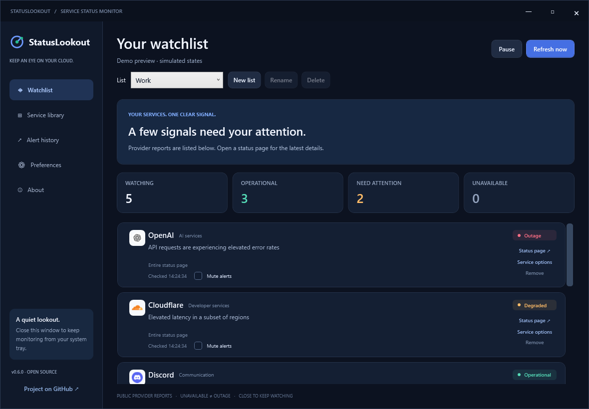
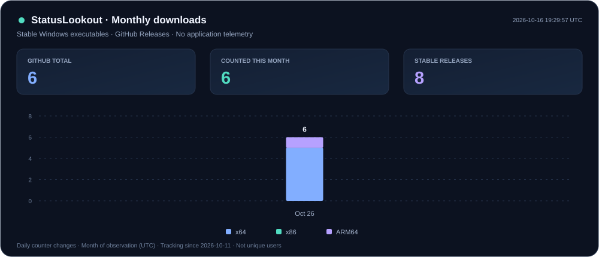
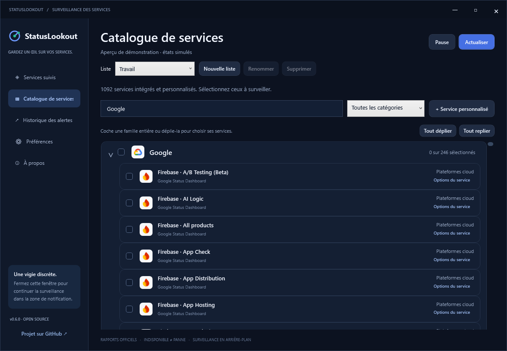
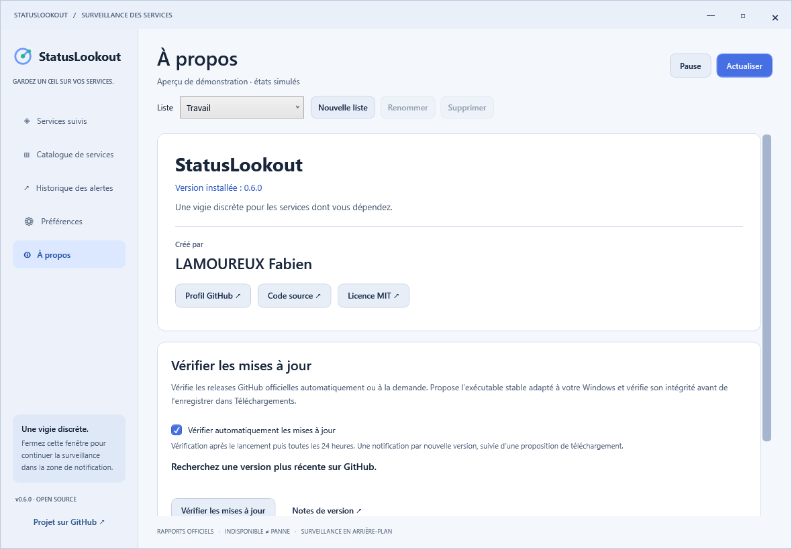

<div align="center">
  
  <h1>StatusLookout</h1>
  <p><strong>Your services. One clear signal.</strong></p>
  <p>A native Windows system tray app for cloud service status,<br>outage alerts, degraded performance and recovery notifications.</p>
  <p>
    <a href="https://github.com/Bouneh/statuslookout/releases/latest"></a>
    <a href="https://github.com/Bouneh/statuslookout/actions/workflows/ci.yml"></a>
    <a href="LICENSE"></a>
    <a href="#download-activity"></a>
    
  </p>
  <p><a href="#download">Download</a> · <a href="#download-activity">Statistics</a> · <a href="#how-it-works">How it works</a> · <a href="#build-from-source">Build</a> · <a href="CONTRIBUTING.md">Contribute</a> · <a href="docs/README.fr.md">Français</a></p>
</div>



*Actual application UI. This screenshot uses simulated incidents, clearly marked as a demo.*

## A quiet lookout for the services you depend on

StatusLookout keeps your selected services in the Windows system tray and alerts you when their published status changes. Choose from **1,092 services and products**, including AWS, GitHub, Cloudflare, Discord, OpenAI, Notion, Slack, Google Cloud and Firebase.

- **Bundled service logos** for all 1,092 catalog entries, with platform logos shared by related products.
- **Monitoring lists**: Work and Personal by default, plus your own named lists. Switch the active list from any page.
- **Automatic update checks**: a notification and download offer for each new stable release, with an opt-out in About.
- **English by default, French available**, with an instant language selector.
- **Light, dark and Windows system themes**, applied immediately and remembered across restarts.
- **Outage, degradation and recovery alerts**, with separate preferences for each.
- **Native Windows notifications**, with a system tray balloon fallback.
- **Collapsible provider families**: select all Google, AWS, Apple or Adobe services, or expand the family and choose individual products. Search reveals matching children; partial selections are shown clearly.
- **Searchable service library** and custom Statuspage-compatible or Instatus endpoints.
- **Related incident grouping**, per-service 30-minute / 1-hour alert snoozing, muting and notification sound controls.
- **Component picker** for Statuspage, Instatus, AWS and Google products, with saved per-service selections.
- **Preference import/export** to move watchlists and custom services between PCs.
- **Windows sign-in startup**, minimized launch and background monitoring when the window is closed.
- **Local alert history**, retained across restarts, with duplicate suppression.
- **Clear unavailable states** for connection failures, timeouts and unreadable provider data.
- **Portable executables** for x64, x86 and ARM64, with the .NET runtime included.
- **No account or telemetry.** No central monitoring server.
- **Stream Deck companion plugin**: live service logos and status, overview, refresh and alert snooze keys.

## Download activity



Updated automatically every day and after Windows releases. Counts cover stable Windows `.exe` downloads, including the early UptimeKite releases; they do not represent unique users. Monthly activity is collected from changes in GitHub's download counters, starting in October 2026. Earlier monthly history is unavailable. See the [counting method and public data](docs/metrics/README.md).

## Download

Download from the [latest GitHub release](https://github.com/Bouneh/statuslookout/releases/latest).

| Your computer | Executable |
| --- | --- |
| Most Intel / AMD Windows PCs | [StatusLookout-win-x64.exe](https://github.com/Bouneh/statuslookout/releases/latest/download/StatusLookout-win-x64.exe) |
| Windows on ARM, including Snapdragon PCs | [StatusLookout-win-arm64.exe](https://github.com/Bouneh/statuslookout/releases/latest/download/StatusLookout-win-arm64.exe) |
| 32-bit Windows | [StatusLookout-win-x86.exe](https://github.com/Bouneh/statuslookout/releases/latest/download/StatusLookout-win-x86.exe) |

**Windows 10 22H2 or Windows 11.** An internet connection is required to check providers. No administrator access or separate .NET installation is needed. Builds are currently unsigned; Windows can show an unknown-publisher warning.

1. Save the executable in a permanent folder.
2. Run it and open **Service library** to choose your services.
3. Open **Preferences → Send test alert** to verify Windows notification delivery.
4. Enable **Launch at Windows sign-in** if you want automatic monitoring.
5. Close the dashboard to keep it in the tray. Use the tray menu to quit.

Release downloads include SHA-256 checksums. To verify an executable:

```powershell
Get-FileHash .\StatusLookout-win-x64.exe -Algorithm SHA256
```

Compare the result with the matching `SHA256SUMS-win-x64.txt` file.

## Stream Deck

[StatusLookout for Stream Deck](plugins/streamdeck/README.md) lives in this repository and is packaged automatically with app releases.

Use **StatusLookout 0.5.0+** and **Stream Deck 7.1+** on the same Windows account. Install `StatusLookout-streamdeck-0.2.0.streamDeckPlugin` from the [latest release](https://github.com/Bouneh/statuslookout/releases/latest), then drag an action from the **StatusLookout** category onto a free key.

| Key | Display / action |
| --- | --- |
| Service status | Logo and live status; press to open its status page |
| Overall status | Watched, affected and unavailable counts; press to open the app |
| Refresh services | Trigger a watchlist check |
| Snooze service alerts | 30-minute / 1-hour snooze; press again to end it |

Search the complete built-in and custom catalog, including AWS and custom services such as Mailjet. Selecting a service on a key enables its monitoring in the desktop app; existing monitored services are marked with a check. Key settings offer English, French or the desktop app's language. The connection uses a Windows pipe restricted to your account, with no HTTP listener or duplicate provider polling. If the app is closed, keys show **Offline** and reconnect automatically. These are display-key actions; dials and pedals are not supported.

## Monitoring lists

Use the **List** selector above the dashboard to switch between **Work** and **Personal**. When upgrading, the existing watchlist becomes Work and Personal starts empty. **New list** creates an empty custom list; select its services in the catalog. Custom lists can be renamed or deleted. Work and Personal remain available.

Only the active list is monitored and used by Stream Deck. Lists have independent service selections; custom service definitions, component scopes and alert settings are shared. All lists and the last active list are saved locally and included in preference export/import.



See [CHANGELOG.md](CHANGELOG.md) for the changes in StatusLookout 0.6.0 and Stream Deck 0.2.0.

## Language and appearance

Open **Preferences → Appearance & language** to choose **English / Français** and **Dark / Light / Follow Windows theme**. English and dark are the initial defaults. Changes apply immediately to the interface, status labels, tray menu and alert titles, and are stored locally. The system option follows the Windows app theme, including changes while running. Provider incident descriptions are kept in their original language, exactly as published.


### Upgrading from the early UptimeKite preview

Quit the old app from its tray menu before running StatusLookout. If you enabled startup in the old app, disable it there and enable it in StatusLookout. To keep the old watchlist and history, copy `preferences.json` and `state.json` from `%LOCALAPPDATA%\UptimeKite` into `%LOCALAPPDATA%\StatusLookout` while both apps are closed. Existing files without language settings default to English.

## About and updates

Open **About** for the installed version, **LAMOUREUX Fabien**’s [GitHub profile](https://github.com/Bouneh), the source repository and the MIT license.

Automatic update checks are enabled by default: the first check runs 30 seconds after launch, then every 24 hours while the app is running. A failed check retries after an hour. A Windows notification is sent once per newer version, with a **Download update** button; a banner also opens the update controls. Disable **Automatically check for updates** in **About** to stop background checks.

Click **Check for updates** to query this repository’s latest stable GitHub release manually. If it is newer, **Download** retrieves the executable for your Windows architecture. A progress bar and cancel button are provided. The downloaded file is checked against GitHub’s SHA-256 digest before being saved to your Windows **Downloads** folder with its version in the filename. Failed or cancelled downloads are removed.

Click **Open download folder**, quit the running app, then replace your old portable executable with the downloaded one. Keep it at the same path to preserve your startup shortcut, or disable and re-enable startup after moving it. Your watchlist and preferences remain in the local data folder. Updates are downloaded on request; the running executable is not silently replaced or launched.



### Service logos

All catalog entries have locally bundled brand favicons. Google Cloud, Firebase and regional Sendbird products use their parent platform logo. Custom services reuse matching bundled logos or retrieve the favicon published by their HTTPS status page, including Mailjet. Raster icons are cached locally for 30 days. If no readable icon is available, initials are displayed. Built-in logo display makes no network requests; custom icon discovery contacts the status page and its icon host.

## How it works

StatusLookout polls the **official public status APIs** for your selected providers. The default interval is 60 seconds and can be set to 30–900 seconds.

| Signal | Meaning |
| --- | --- |
| Operational | The provider reports normal operation |
| Degraded | Reduced performance or a partial outage |
| Outage | A major service disruption |
| Maintenance | The provider reports maintenance |
| Unavailable | The status API could not be checked or its response could not be parsed |

A connection failure **does not create an outage alert**. The last confirmed state is kept, so a subsequent confirmed recovery can still be detected. Identical states do not generate repeated alerts. By default, an already affected service triggers an alert on its first check; this is configurable.

Providers sharing a status endpoint are fetched once per refresh. Requests are limited to six at a time, with a 20-second timeout. Closing the window keeps monitoring active; quitting the app, sleeping or turning off the PC stops checks. Alerts reflect polling and provider publication delays.

A green signal reflects a provider's aggregate report; individual users or requests may still experience issues.

### Supported status formats

| Adapter | Examples / coverage |
| --- | --- |
| Statuspage-compatible JSON | GitHub, Cloudflare, Discord, OpenAI and supported incident.io pages |
| Instatus public summary | Supported pages exposing `summary.json` |
| Status.io v1 | Catalog entries with a public status ID |
| Google Status Dashboard JSON | 217 Google Cloud products, 26 Firebase products and aggregate dashboards |
| Slack Status API | Active Slack incidents |
| Apple public status feed | Apple and Apple Developer, with product scopes |
| Adobe status events | Adobe clouds and products |
| Microsoft status dashboards | Azure regions and Azure DevOps products |
| Salesforce public instance status | Product and region scopes |
| Other public APIs | Algolia, Broadcom, Fivetran, PayPal, PlayStation, Railway, Stripe, Upsun, Zendesk, Civo, Codacy, Site24x7, Sorry, StatusCake and StatusHub |
| Public HTML dashboards | incident.io, Better Stack, Better Uptime, PagerDuty, StatusCast, Statuspal, Beanstalk, Fastly, Okta and Uptime.com |
| AWS Health public events | Aggregate AWS status, 267 products and 36 regions |

The shipped catalog covers **all 1,048 entries** of the pinned [stts catalog](https://github.com/inket/stts/blob/876ecac0996c719786477af8e3833cdac05235ba/Resources/services.json), plus additional current products. An entry-by-entry correspondence is stored in [stts-coverage.json](src/StatusLookout.Core/Catalog/stts-coverage.json); raw counts alone are not used to claim parity. Providers can change endpoints or block automated requests. Those checks display **Unavailable** and retain the last confirmed state.

**Custom services:** enter a public HTTPS status page and select its API format. StatusLookout validates the response before adding it. For catalog and custom services, open **Service options → Choose components** to select published APIs, regions or products. Statuspage and Instatus choices come from their public summary API; Google and AWS product / region choices come from the shipped catalog. AWS product and region selections intersect to narrow the scope. Select no components to monitor the entire page, or use **Catalog default** to restore the original scope. Providers without a supported component list keep their aggregate status. Changing scope establishes a fresh baseline. Custom Statuspage component IDs can also be entered when adding a service.

### AWS scope

AWS monitoring uses the public Health dashboard feed without an account or credentials. Public active events are reported as confirmed issues (Degraded), without guessing a severity that this feed does not reliably define. Choose a region, such as Paris, to avoid mixing unrelated regional incidents into your signal. This does not cover account-specific AWS Health events.

### Notifications and startup

Notification preferences are independent for outages, degraded service, recovery and maintenance. Muting a service silences its alerts while retaining its monitoring and history.

**Group related incident notifications** is enabled by default. Within each refresh, services on the same API with the same published incident IDs and alert kind share a single notification. Different incidents and unidentified incidents stay separate; individual activity entries are retained. Recovery uses the last known incident identity.

Open **Service options** to snooze alerts for **30 minutes** or **1 hour**, or end the temporary pause. Monitoring, tray status and history continue. The expiry is stored across app restarts; snoozed transitions are not replayed afterwards. Permanent muting remains independent.

Windows **Do not disturb**, notification permissions and system policies can suppress banners. The test alert helps check delivery. If toast registration fails, StatusLookout falls back to a tray balloon.

Startup uses a per-user entry in `HKCU\Software\Microsoft\Windows\CurrentVersion\Run`. It starts the executable with `--background`. If you move the executable, disable and re-enable the option to update its path.

### Local data and privacy

Preferences and the last 300 confirmed status changes are stored in:

```text
%LOCALAPPDATA%\StatusLookout\preferences.json
%LOCALAPPDATA%\StatusLookout\state.json
```

The app sends HTTPS requests directly to selected status providers. Those providers receive your normal network request metadata, including your IP address. Automatic update checks, when enabled, and manual update checks additionally contact api.github.com. Requested downloads contact GitHub’s release download servers. StatusLookout adds no analytics or tracking.

**Preferences → Local data** provides JSON **Export preferences / Import preferences**. Import replaces the current watchlist, custom services, component selections, language, theme and alert preferences after validating the file. Export first to keep a backup. Startup registration, history, cached logos and temporary snoozes are not transferred. Import does not change Windows sign-in startup.

To remove the app, disable startup, quit from the tray and delete the executable. You can also delete the data folder to remove preferences and history.

## Build from source

Install the [.NET 10 SDK](https://dotnet.microsoft.com/download/dotnet/10.0) on Windows, then:

```powershell
git clone https://github.com/Bouneh/statuslookout.git
cd statuslookout
dotnet build StatusLookout.sln -c Release
dotnet run --project tests/StatusLookout.Tests -c Release
dotnet run --project src/StatusLookout.Windows -c Release
```

The offline test suite covers parsing, state transitions, recovery after network failure, duplicate suppression, persistence, request grouping and cancellation.

Publish self-contained executables:

```powershell
.\scripts\Publish.ps1
# Or only one architecture:
.\scripts\Publish.ps1 -Runtimes win-x64
```

Outputs are written to `artifacts/`. WPF is not trimmed. Native runtime files are bundled and extracted by .NET on first launch when necessary.

### Developer tools

```powershell
# Preview simulated incidents without altering user preferences:
dotnet run --project src/StatusLookout.Windows -- --demo

# Render the actual WPF layout to a screenshot:
dotnet run --project src/StatusLookout.Windows -- --preview assets/screenshot.png
# French, light theme and preferences preview (no settings are saved):
dotnet run --project src/StatusLookout.Windows -- --preview assets/preferences.png --french --light --settings

# Audit public endpoints (network access, no notifications):
dotnet run --project tests/StatusLookout.Tests -- --audit
```

## Automatic Windows releases

[CI](.github/workflows/ci.yml) builds the app and runs offline tests on pushes and pull requests.

[The release workflow](.github/workflows/release.yml) publishes all three architectures on a `v*` tag or a manual workflow run. Tag runs create a GitHub release with executables, checksums and license notices. No external signing credentials are required.

```powershell
git tag v0.6.0
git push origin v0.6.0
```

An x64 machine can build all architectures. Native x86 and ARM64 runtime testing still requires suitable hardware.

## Contributing

Created by **LAMOUREUX Fabien** ([Bouneh on GitHub](https://github.com/Bouneh)).

See [CONTRIBUTING.md](CONTRIBUTING.md) for adding services, adapters and tests. Bug reports and feature ideas are welcome through [GitHub Issues](https://github.com/Bouneh/statuslookout/issues).

## Credits and license

StatusLookout is an independently implemented Windows application inspired by the useful monitoring workflow of [stts](https://github.com/inket/stts). The Windows code, visual identity and interface are original. Selected service definitions and brand favicons are adapted from stts with attribution. Brand artwork remains the property of its respective owners.

Google / Firebase product identifiers are taken from their public status dashboards. Service names belong to their respective owners; this project is not affiliated with those providers.

Released under the [MIT license](LICENSE). See [THIRD-PARTY-NOTICES.md](THIRD-PARTY-NOTICES.md).
