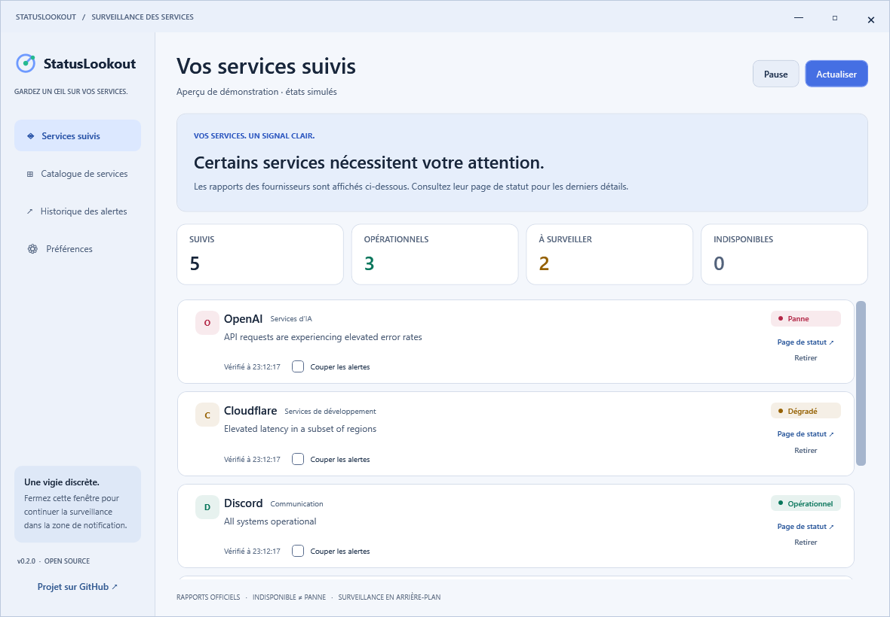

# StatusLookout

**Tes services. Un signal clair.**

StatusLookout est une application Windows native qui surveille les pages de statut de services cloud depuis la zone de notification.



*Capture de l'application en mode démonstration, avec incidents simulés.*

## Télécharger

Choisis ton architecture dans la [dernière version](https://github.com/Bouneh/statuslookout/releases/latest) :

- **x64** : la plupart des PC Intel et AMD.
- **ARM64** : PC Windows ARM / Snapdragon.
- **x86** : Windows 32 bits.

Le fichier `.exe` est autonome, avec .NET inclus. Il fonctionne sur Windows 10 22H2 et Windows 11, sans droits administrateur. Les versions ne sont pas encore signées numériquement.

## Utilisation

1. Place le fichier dans un dossier permanent et lance-le.
2. L’anglais est la langue par défaut. Ouvre **Preferences → Appearance & language**, puis sélectionne **Français**. Le changement est immédiat et mémorisé.
3. Dans **Préférences → Apparence et langue**, choisis le thème **Clair** ou **Sombre**.
4. Ouvre le **Catalogue de services**, recherche et coche les services à surveiller.
5. Dans **Préférences**, sélectionne les alertes et utilise **Envoyer une alerte de test**.
6. Active ou désactive **Lancer à l’ouverture de session Windows** selon ton choix.
7. Ferme la fenêtre pour continuer la surveillance. Utilise **Quitter StatusLookout** dans la zone de notification pour l’arrêter.

Les titres des alertes et le menu de la zone de notification suivent la langue sélectionnée. Les descriptions d’incident restent dans la langue publiée par les fournisseurs.

Le catalogue contient **461 services et produits**. Tu peux ajouter une page de statut personnalisée compatible Statuspage ou Instatus.

Les vérifications ont lieu toutes les 60 secondes par défaut. L'intervalle peut varier de 30 à 900 secondes. Une erreur réseau produit un état **Indisponible**, sans être confondue avec une panne confirmée.

L'historique des 300 derniers changements et les préférences restent dans `%LOCALAPPDATA%\StatusLookout`. Les états confirmés sont conservés entre les démarrages pour éviter les alertes répétées et détecter les rétablissements.

Les alertes dépendent des informations publiées par les fournisseurs et des réglages de notifications Windows. La surveillance fonctionne tant que l'application tourne et que le PC est connecté et éveillé.

## Développement

Installe le SDK .NET 10 sur Windows :

```powershell
dotnet build StatusLookout.sln -c Release
dotnet run --project tests/StatusLookout.Tests -c Release
.\scripts\Publish.ps1
```

GitHub Actions construit et publie les exécutables x64, x86 et ARM64 lors d'un tag `v*`. Le code est sous licence MIT. Voir le [README complet](../README.md) et les [instructions de contribution](../CONTRIBUTING.md).
